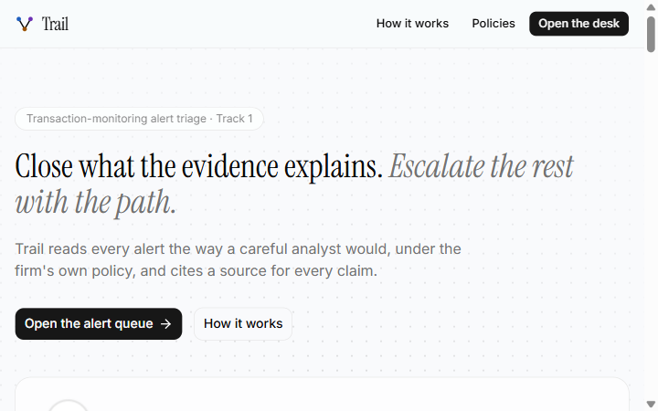
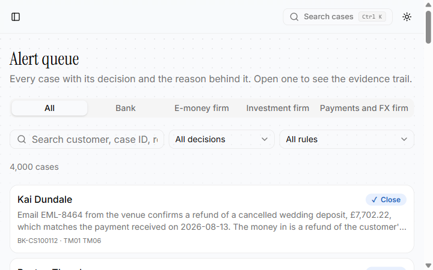
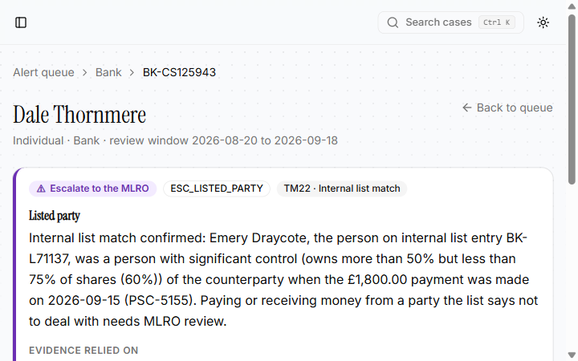
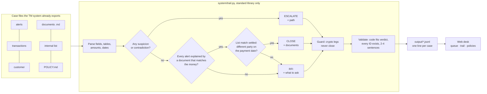

<h1 align="center">Trail</h1>

<p align="center"><b>Close what the evidence explains. Escalate the rest with the path.</b><br/>
A deterministic triage engine for transaction-monitoring alerts. It follows each firm's own policy, cites a source for every claim, and gives the same answer every time.</p>

<p align="center">
  <a href="https://trail-rose-one.vercel.app">Live desk</a> ·
  <a href="system/README.md">How the engine decides</a> ·
  <a href="#run-it">Run it</a> ·
  <a href="#accuracy">Accuracy</a>
</p>

Built solo in one day at the **Grok Bot London Financial Crime Hackathon**, Saturday 21 November 2026. Track 1, "Stop suspicious payments: build a system that closes alerts safely", designed by Diligent.

<p align="center">
  
  
  
</p>

---

## The problem

Every bank, payment firm and investment platform runs monitoring rules that raise alerts on unusual activity. Most alerts turn out to have an ordinary explanation: a car sale, an inheritance, an invoice. Every one still needs an analyst to read the customer's profile, transactions and documents before deciding.

The cost of getting it wrong is lopsided. Closing an alert that needed attention lets scam money or laundered funds through. Asking a suspect for documents can tip them off, which is an offence. Escalating everything buries the MLRO.

| | |
|---|---|
| **£576.4m** | lost to authorised push payment (APP) scams in the UK in 2025, up 19% on the year before, across 248,070 cases ([UK Finance, Annual Fraud Report 2026](https://www.ukfinance.org.uk/news-and-insight/press-release/fraud-report-2026-press-release)) |
| **£221.5m** | of that came from investment scams, up 40%: the largest APP category (same source) |
| **20–60 min** | per alert review, across five or six systems (as described on [Zomma's YC page](https://www.ycombinator.com/companies/zomma)) |
| **10×** | the cost of a wrongful close compared with asking the customer, in this track's own scoring |

### Who it is for
- **L1 and L2 transaction-monitoring analysts.** Half the queue arrives already closed, with a reason that names the documents. The rest arrives with the one thing to ask for, or the path to escalate.
- **MLROs.** Escalations come with the trail: who controlled the payee on the payment day, which bank reported the scam, which staff note recorded the structuring question.
- **Payments and FX firms.** A held payment of £10,000 or more to a third party is released only when an invoice or contract on file matches it.
- **QA, model-risk and independent testing teams.** Any decision can be replayed. Five runs give identical bytes, and renaming every ID changes nothing.

### The gap

| | Who | What's missing |
|---|---|---|
| **AI agents** | Unit21, Axle, Zomma, Bretton | They decide with a language model, so runs can disagree and the reason is hard to replay. |
| **Graph tools** | Quantexa, Linkurious, Sayari | They show who is connected to whom. A person still has to read it and decide. |
| **Trail** | Policy as code | It compiles the firm's own SOP into checks, decides, and cites a source for every link. Same input, same answer. |

## What Trail does

| | |
|---|---|
| **One decision per case** | `CLOSE`, `RFI` or `ESCALATE`, with one of 26 reason codes, a 2–4 sentence reason naming the case's own people, amounts and documents, and the evidence IDs it relied on. |
| **Suspicion first** | Any sign of crime escalates, and the customer is never asked, so there's no tipping off. Signals include:<br/>• sending-bank fraud reports<br/>• money-mule "job" scripts<br/>• third parties investing through the account<br/>• structuring questions in staff notes<br/>• one device logging in to several customers<br/>• "a loan from a friend" that came from a dissolved company<br/>• conflicting stories<br/>• evasive directors<br/>• pass-through to newly formed companies<br/>• crypto legs on rapid movement |
| **Proof before any close** | A document closes a case only when its amount matches the money behind the alert to the penny, and it isn't contradicted by:<br/>• a sale receipt in someone else's name<br/>• an insurance schedule showing the car wasn't sold<br/>• a carrier saying the goods never shipped<br/>• a group chart that the payer's register disproves |
| **Control on the payment date** | For internal-list matches it reads officer and PSC registers and checks who controlled the payee **on the day the money moved**:<br/>• A listed person still holding 60% → escalate.<br/>• They resigned the day before → close.<br/>• Control handed to someone with the same surname → ask, not close (the family-proxy typology the FCA flagged in May 2026). |
| **One thing to ask** | When nothing is suspicious but something is unexplained, the RFI says exactly what to request: the facility agreement, the statement proving the account is the customer's own, the invoice behind four payments just under £10,000. |
| **Each firm's own policy** | Limits and country lists are read from each institution's `POLICY.md`, for example the 5× own-account rule and the higher-risk country list. Four firms, four rulebooks, one engine. |
| **A desk for analysts** | The web app has:<br/>• a searchable queue (works on phones)<br/>• a case page with the evidence trail: what fired → money moved → who is involved → documents → decision, with every box opening its source<br/>• a text-path alternative for screen readers<br/>• each firm's policy<br/>• the assurance results |

## How Trail works



- **No model in the decision path.** Verdicts, codes, reasons and evidence all come from rules and templates. There is no API key, no network and no cost, and there is nothing for a document's text to inject into.
- **Deterministic.** No clock, no randomness, sorted evidence, input order kept. Same bytes in, same bytes out.
- **Fails safe.** Anything it can't recognise falls to RFI or ESCALATE, never CLOSE. A case that throws an error is escalated with a stated reason, not dropped.

Full decision tables, measured numbers and worked cases are in [`system/README.md`](system/README.md).

## Accuracy

The development cases come without answers, so we measured Trail three independent ways.

| Test | What it is | Result |
|---|---|---|
| **Blind gold sample** | A fresh AI session that never saw the code labelled 60 cases (15 per institution) from the brief and each POLICY.md alone. | **60/60 verdicts agree**, 0 wrongful closes, 31/31 closable cases closed, cost per case 0.00 (escalating everything: 2.12). Reason codes agree on 58/60. |
| **Adversarial test set** | 120 new cases built by a separate session from real typologies: mule jobs, romance and pig-butchering scams, cuckoo smurfing, invoice redirection, phantom shipments, family proxies, account takeover, crypto off-ramps. They use deliberately different wording and edge cases. | **0 wrongful closes**, 90/120 verdicts agree, cost per case 0.74 (escalating everything: 1.73). Most remaining misses are escalations sent as RFIs, which cost 3, not 10. |
| **Robustness on all 4,000 dev cases** | `repro.sh`, `perturb_test.py`, `counterfactual_test.py`, `validate.py` | 5/5 runs byte-identical. Renaming every ID and shuffling every file changes **0** verdicts. Removing each close's cited documents turns **all 2,000** closes into RFIs. 0 validator errors. |

**Caveats:**
- Sixty and 120 cases are small samples.
- The labellers were AI sessions, not human analysts.
- The organisers score 800 unseen cases we haven't seen, which may word free text in ways we haven't met. Treat these numbers as a check, not proof.

## Run it

The engine uses only the Python 3 standard library and installs nothing.

```bash
system/run <institution folder> <output file>                  # e.g. system/run institutions/bank output/bank.jsonl
python system/validate.py <institution folder> <output file>   # one line per case, valid codes, cited IDs exist
system/repro.sh <institution folder>                            # 5 runs, prints the hashes
python tests/perturb_test.py <institution folder>               # rename every ID + shuffle: 0 verdicts may change
python tests/counterfactual_test.py <institution folder> <output file>
python tests/score.py <labels.csv> output/*.jsonl               # cost per case with the track's cost matrix
```

The web desk (Next.js 16, shadcn/ui, Magic UI, motion) reads case files built locally from the engine's output:

```bash
python viewer/build.py <path to institutions> output   # writes web/public/data (git-ignored)
cd web && npm install && npm run dev
```

The hackathon dataset is the organisers' and isn't included in this repo.

## Repo layout

| Path | What it is |
|---|---|
| `system/run`, `system/trail.py` | The scored engine (one file) and its wrapper |
| `system/validate.py`, `system/repro.sh` | Output checks and the 5-run hash proof |
| `output/*.jsonl` | The engine's decisions on the 4,000 development cases |
| `tests/` | Rename-and-shuffle, counterfactual, cost-matrix scorer, labelling-sheet generator |
| `web/` | The analyst desk |
| `viewer/` | Data builder and a single-file trail viewer |
| `docs/` | Plan and business case, ranked feature list, submission checklist, research prompt |

## Safety by design
- **No model decides.** A rules engine is auditable line by line, and deterministic rule-based processes fall outside the "model" definition in the US interagency guidance SR 26-2.
- **Unknown never closes.** Unrecognised documents or wording lead to RFI or ESCALATE.
- **No tipping off.** Once there is suspicion, Trail escalates. RFI wording never mentions a list match or a suspicion.
- **Context isn't a trigger.** Round amounts, a shared IP, a same-day payee, and crypto or gambling on their own add context only, as the policies say.
- **Soft links don't decide.** A shared name, a shared address or a masked IBAN ending never escalates or closes on its own.
- **Data stays put.** The engine reads only the folder it's given and writes only its output file. Nothing leaves the machine.

## What's next
From [`docs/FEATURES.md`](docs/FEATURES.md):
- a money-flow view of each account's full history, with flagged hops by country
- a relationship map for proxies and nominees
- a "why not CLOSE?" button that shows the single missing fact
- a policy playground that re-sorts the queue when a limit changes
- an optional cached model labeller for free text the rules have never seen, which may only push towards ESCALATE

<p align="center"><sub>All customers, companies and documents in the hackathon data are invented.</sub></p>
